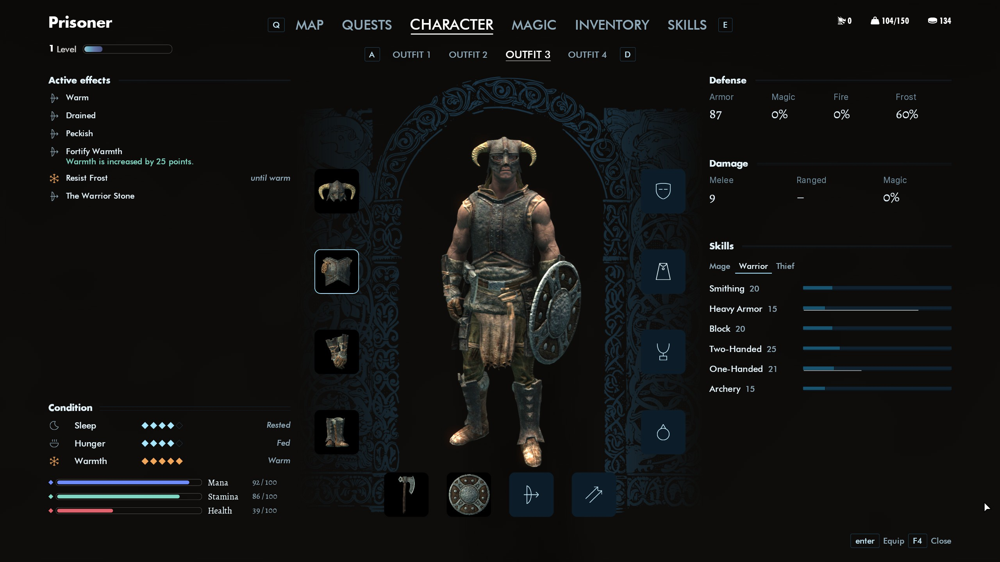

# Skyrim Modern UI

A Skyrim Special Edition mod that replaces the character sheet with a modern screen: the player's own character
in the middle, framed by an arch, with equipment, outfits, active effects, survival needs, defense, damage and
skills around it. The screen is a web page (Svelte) shown in game through [Prisma UI](https://www.prismaui.dev),
fed by a small SKSE plugin.

**Status: working prototype.** The Character and Inventory tabs work in game; the other tabs in the top bar
(Map, Quests, Magic, Skills) are placeholders.



## What works

- The player's character, alive and animated, on a black background behind the UI.
- Twelve equipment slots. Click a slot (or select it and press Enter) to pick from everything in the inventory
  that fits, and for the hands the spells the player knows; the "Nothing" row takes the item off.
- Item pictures, made in game from the items' 3D models the first time the screen opens.
- Four outfits per save game. Switching stores what is worn and puts on the other set.
- Active effects with time left; condition (sleep, hunger, warmth) with Survival Mode on; health, magicka,
  stamina; defense and damage; skills grouped as Mage / Warrior / Thief.

## Try it in game

Tested on Skyrim SE 1.7.104 (the current Steam version) on Linux through Proton. Windows has not been tried
yet, but nothing in the mod is Linux-specific.

Install with a mod manager (Mod Organizer 2 or Vortex), in this order:

1. [SKSE64](https://skse.silverlock.org) for your game version.
2. [Address Library for SKSE Plugins](https://www.nexusmods.com/skyrimspecialedition/mods/32444) (All in One).
3. [Prisma UI](https://www.nexusmods.com/skyrimspecialedition/mods/148718) 1.5 or newer.
4. This mod: the `SkyrimModernUI-<version>.zip` from
   [Releases](https://github.com/jakub-chatrny/skyrim-modern-ui/releases).

Start the game through SKSE, load a save, press **Tab**. The game's own Tab menu (Skills, Items, Magic, Map)
moves to **F4**. To use another key, set `"toggleKey"` in `Data/SKSE/Plugins/SkyrimModernUI.json` (`"Tab"`,
`"F1"` to `"F12"`, `"Insert"`, `"Home"`, `"End"`, `"PageUp"`, `"PageDown"`, some letters, or a DirectInput scan
code); whatever the game did with that key during play moves to F4.

| Key | Does |
|---|---|
| Tab | Open and close the screen (Esc is left to the game) |
| F4 | The game's own Tab menu |
| Q / E | Switch between the Character and Inventory tabs |
| W / S, arrow keys, mouse | Move the selection (on Character, W / S go round the twelve tiles) |
| R | Drop the selected item (a tile, a grid item, or the highlighted row of an item list) |
| F | Mark or unmark the selected item as a favourite |

Character tab:

| Key | Does |
|---|---|
| Enter, Space, click | Open the item list of the selected slot, pick an item |
| A / D | Previous / next outfit |
| 1 – 4 | Outfit 1 to 4 |
| X | Take off the selected tile's item |
| Drag on the character, Z / C | Turn the character |

Inventory tab:

| Key | Does |
|---|---|
| A / D | Previous / next category (All, Weapons, Armor, Potions, Food, Ingredients, Books, Misc) |
| Enter, click | Equip or take off gear; drink, eat or use potions, food and ingredients |
| Drag on the item, Z / C | Turn the 3D item |
| Sort buttons (mouse) | Sort by name, type, weight, value or value per weight; click again to reverse |

Camera framing and other settings are in `Data/SKSE/Plugins/SkyrimModernUI.json`; it is read every time the
screen opens, so changes need no restart. On Linux the Proton prefix needs a current Visual C++ runtime for
Prisma UI: `protontricks 489830 vcrun2022`.

### Known issues

- **Low roofs can still zoom in.** Near walls and in corners the screen turns the character toward open space
  (or brings the camera closer), but under a low roof edge the game's camera can still end up right at the
  character. Step out from under it before opening the screen.
- **No gamepad support yet.** Keyboard and mouse only.
- **Only the Character and Inventory tabs exist.** Map, Quests, Magic and Skills do nothing yet.
- **Books cannot be read from the Inventory tab** yet; use the game's own inventory.
- **Rarity is ours, not the game's.** Items with one enchantment are rare (blue frame), two are epic (purple);
  unique items and Daedric artifacts are legendary (gold).

## Design

Figma: [Skyrim UI](https://www.figma.com/design/XysgSJjTgysHlN2y6StFND/Skyrim-UI?node-id=2007-3644), frame
"Character / Iter 4" (2507 x 1511), and
[Skyrim Modern UI](https://www.figma.com/design/UNyXAYouKVcPGIP56lT4UV/Skyrim-Modern-UI?node-id=13-3635), frame
"Inventory / Iter 3" (2507 x 1480). Each screen is built at its frame's pixel sizes and scaled to fit the window
(`ui/src/screens/CharacterScreen.svelte`, `InventoryScreen.svelte`). Assets exported from the files are in
`ui/src/assets/design/iter4/` and `ui/src/assets/design/inventory/`.

Where to find things:

| Part of the screen | File |
|---|---|
| Whole screen, slot layout, arch | `ui/src/screens/CharacterScreen.svelte` |
| Top bar (name, level, tabs, outfits) | `ui/src/components/TopBar.svelte` |
| Left column (effects, condition, vitals) | `ui/src/components/LeftPanel.svelte` |
| Right column (defense, damage, skills) | `ui/src/components/RightPanel.svelte` |
| Equipment tile | `ui/src/components/EquipmentSlot.svelte` |
| Item list popup | `ui/src/components/ItemPicker.svelte` |
| Colours, fonts | `ui/src/app.css` |

### Things to know when designing for it

- **The middle must stay see-through.** The character is the game's 3D render behind the page; anything opaque
  over the centre hides it. The camera framing (how big the character is, where it stands) is set in the
  plugin's settings file, not in the page.
- **No continuous animation.** Prisma UI paints the page on the CPU and the game waits for it: an animated fog
  layer took the game to about 20 fps. Short transitions on a change are fine; loops are not.
- **Large images are cheaper than complex vectors.** The arch is a picture rendered from the Figma vector
  (1.1 MB of paths) for that reason.
- **Keyboard and gamepad first.** Everything has to be reachable without a mouse; there must always be a visible
  selected element. Gamepad support is planned but not done.
- **The game's data decides what can be shown.** For example damage is one number per weapon, not a range;
  Survival Mode has no thirst; there are no item pictures in the game's files (the mod makes its own).

### Where the build departs from the file

- **Fonts.** The design uses Futura (Bold, Md BT, BdCn BT), which is commercial and not bundled. Jost and
  Barlow Condensed stand in; the real fonts are used if they are installed. Alegreya and Inter are bundled.
- **Background.** The file's background is a very dark blue (#070b10); in game the background is the black
  behind the character.
- **Close hint.** The file says "esc Close"; the screen closes with its own key (Tab by default), so the hint names that key.
- **Damage.** The file shows ranges (38–46); the game has one number per weapon. "Magic" is the Destruction
  power bonus until there is a better definition.
- **Skills.** The level is shown, muted, after each name. The tab opens on the tree with the most levels.
- **Effects.** One icon per kind (cold, food, other), from the file's three.
- **Condition.** Shown only with Survival Mode on; the state words ("Rested", "Peckish") are ours.
- **Selection and item list.** Not in the file: the selected tile has a ring in the accent colour, and the item
  list popup uses the file's colours. Both need a proper design.

## Roadmap

| Phase | State |
|---|---|
| 0 – Prisma UI under Proton | done ([notes](docs/phase-0-prisma-proton.md)) |
| 1 – Build toolchain | done (Linux cross-compile; Windows CI workflow written, not run yet) |
| 2 – Character on a black background | done ([notes](docs/phase-2-character-rendering.md)) |
| 3 – Data from the game | done |
| 4 – Character screen | done for keyboard and mouse; gamepad parked |
| 5 – Outfits | done |
| 6 – Other tabs, release | not started |

Full plan: [docs/plan.md](docs/plan.md). How the pieces work: [docs/technical.md](docs/technical.md).

## For developers

```
plugin/    C++ SKSE plugin (CommonLibSSE-NG, CMake presets, clang-cl cross-compile)
ui/        Svelte + Vite web app, builds to ui/dist
shared/    message schema and sample data used by both sides
scripts/   deploy.sh, package.sh, logs.sh, phase0-check.sh
docs/      plan, spike results, technical notes
```

Setup:

```
git submodule update --init --recursive
cp .env.example .env        # then set SKYRIM_FOLDER
```

UI:

```
cd ui
npm install
npm run dev      # browser preview on sample data (shared/fixtures/character.json); no character
npm run check    # types
npm run build    # ui/dist, one classic script (no ES modules) for Prisma UI
```

Plugin toolchain (Linux):

```
sudo pacman -S clang lld llvm cmake ninja zip
cargo install xwin
xwin --accept-license splat --output ~/.xwin   # accepts Microsoft's licence terms
cd plugin
./lib/vcpkg/bootstrap-vcpkg.sh -disableMetrics
cmake --preset release-linux
cmake --build --preset release-linux           # build/release-linux/SkyrimModernUI.dll
```

On Windows, `.github/workflows/build.yml` builds the DLL on a GitHub runner (not run yet); pass the result to
the scripts with `--dll <path>`.

Build, run, debug:

```
scripts/deploy.sh           # build UI + plugin, copy into DEPLOY_DIR or the game's Data folder
scripts/deploy.sh --ui-only
scripts/package.sh          # build both and zip them for MO2 / Vortex: release/SkyrimModernUI-<version>.zip
scripts/logs.sh [-f]        # SKSE / Prisma UI / plugin logs from the Proton prefix
scripts/phase0-check.sh     # what is installed in the game folder (read-only)
```

Everything the page writes to its console, including script errors, ends up in `SkyrimModernUI.log` next to
the SKSE logs; there are no browser dev tools in game.

## Licences

- `plugin/CMakeLists.txt`, `plugin/CMakePresets.json` and `plugin/cmake/` are adapted from
  [codepuncher/CommonLibSSE-NG-template](https://github.com/codepuncher/CommonLibSSE-NG-template), which is
  GPL-3.0. The project licence is not decided yet; it has to be GPL-compatible.
- The item picture technique in `plugin/src/Thumbnails.cpp` follows Modex
  ([ModExplorerMenu](https://github.com/patchulidev/ModExplorerMenu)), GPL-3.0 with a modding exception.
- Icons in `ui/src/assets/icons/` are generated from [game-icons.net](https://game-icons.net) (CC BY 3.0, credit
  required) and Material Design Icons (Apache 2.0) by `ui/scripts/extract-icons.mjs`. Icons and the arch in
  `ui/src/assets/design/` come from the Figma file.
- Fonts: Jost, Barlow Condensed, Alegreya and Inter (SIL Open Font Licence), via the `@fontsource` packages.
- `plugin/src/PrismaUI_API.h` is the Prisma UI modder API header, copied as its own comment instructs. Prisma UI
  itself is a runtime dependency and is not redistributed.
