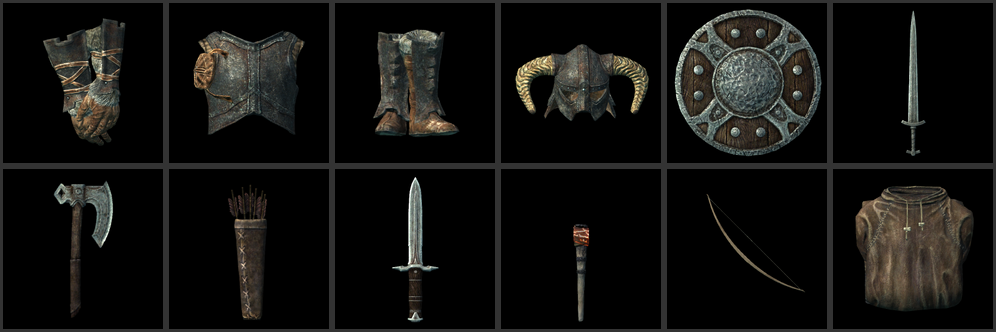

# Skyrim Modern UI

A Skyrim SE mod that replaces the character sheet with a modern web UI
(Prisma UI) fed by a small SKSE plugin. Full plan: [docs/plan.md](docs/plan.md).

## Status

| Phase | State |
|---|---|
| 0 — Prisma UI under Proton | **works with caveats** (needs a current VC++ redistributable in the prefix) — [docs/phase-0-prisma-proton.md](docs/phase-0-prisma-proton.md) |
| 1 — Build toolchain | Linux cross-compile works (clang-cl + xwin); self-built plugin loads and opens its view in game |
| 2 — Character rendering spike | **done**: real player with the world hidden and a black backdrop — [docs/phase-2-character-rendering.md](docs/phase-2-character-rendering.md) |
| 3 — Data bridge | **done**: full snapshot, equip / unequip from the UI, live updates (confirmed in game and in the plugin log, 2026-11-16) |
| 4 — Character screen UI | Figma design, item picker and item pictures confirmed in game; keyboard navigation not yet tried in game, gamepad parked |
| 5 — Outfits | **done**: four outfits, saved with the game, switched from the tabs (confirmed in game 2026-11-16) |

Phases 0 to 3 are done; phase 4 (the Character screen UI from the Figma design) is in progress.

## Layout

```
plugin/    C++ SKSE plugin (CommonLibSSE-NG, CMake presets, clang-cl cross-compile)
ui/        Svelte + Vite web app, builds to ui/dist
shared/    bridge JSON schema + fixture used by both sides
scripts/   deploy.sh, logs.sh, phase0-check.sh
docs/      plan, spike results, decisions
```

## Setup

```
git submodule update --init --recursive
cp .env.example .env        # then set SKYRIM_FOLDER
```

### UI

```
cd ui
npm install
npm run dev      # browser, mock bridge fed from shared/fixtures/character.json
npm run check    # types
npm run build    # ui/dist, one classic script (no ES modules) for Ultralight
```

Outside the game `window.smuiCommand` does not exist, so the bridge falls back
to the fixture and logs commands to the console.

### Plugin toolchain (phase 1, option A)

```
sudo pacman -S clang lld llvm cmake ninja zip
cargo install xwin
xwin --accept-license splat --output ~/.xwin   # accepts Microsoft's licence terms
cd plugin
./lib/vcpkg/bootstrap-vcpkg.sh -disableMetrics
cmake --preset release-linux
cmake --build --preset release-linux           # build/release-linux/SkyrimModernUI.dll
```

Fallback (option B): `.github/workflows/build.yml` builds the DLL on a Windows
runner; download the artifact and run `scripts/deploy.sh --dll <path>`.

### Deploy and debug

```
scripts/phase0-check.sh     # what is installed in the game folder (read-only)
scripts/deploy.sh           # build UI + plugin, copy into DEPLOY_DIR or Data/
scripts/deploy.sh --ui-only
scripts/logs.sh [-f]        # SKSE / Prisma / plugin logs from the Proton prefix
```

In game: **F4** toggles the screen (`TOGGLE_KEY` in
`plugin/src/CharacterMenu.cpp`). F4 is the only key that opens or closes it; Esc is not bound.

## Bridge

Defined in [shared/schema/bridge.schema.json](shared/schema/bridge.schema.json);
TypeScript mirror in `ui/src/bridge/types.ts`, C++ producer in
`plugin/src/Snapshot.cpp`.

The plugin pushes a snapshot when the screen opens, when the UI says `ready`, and whenever the player's
equipment changes while the screen is open. Each snapshot is also written to `SkyrimModernUI.log`, and so is
everything the page writes to its console (`[ui]` lines), including script errors.

What the numbers mean (see `plugin/src/Snapshot.cpp`, `plugin/src/Equipment.cpp`):

- Item armor and damage are the values the game's own menus show (skill, perks, tempering applied).
- A bow or crossbow is reported in `ranged`, not `rightHand`; the game has no separate ranged slot.
- `cloak` and `mask` use the common mod slots (46/47 and 44/55); the base game has nothing for them.
- `damage.magicPower` is the Destruction power modifier for now; the design does not define it yet.
- Skill names are English constants; `survival` is not sent.
- Equip / unequip ignore which exact copy of an item is meant (tempered vs plain); spells cannot be unequipped yet.


### Controls after loading a save

Sometimes, after loading a save, the player could not move or look around until the screen was opened and
closed. Cause (confirmed 2026-11-18: right after a load the log showed exactly Prisma's set disabled): the save
was made while the screen had focus, with Prisma UI's control block in place.
On every load the plugin now logs the enabled control groups and, if exactly Prisma's set is off (looking,
movement, jumping, activate, camera switch, zoom, VATS) while fighting is still on, re-enables them. Works.

### Choosing gear

Clicking a slot asks the plugin for everything in the inventory that fits it (`listItems`) and shows the
answer in a popup; picking a row sends `equip`, the "Nothing" row sends `unequip`.

- Left hand: shields, one-handed weapons, staves, torches. Right hand: any melee weapon or staff.
  Ranged: bows and crossbows. Spells are not listed yet.
- The list is per item type, not per copy: a tempered and a plain copy of the same item are one row.

### Item pictures

There are no item thumbnails in the game's data, so the plugin makes them (`plugin/src/Thumbnails.cpp`).
**Working** (confirmed in game 2026-11-22: all twelve items of the test character in under three seconds, no
failures). On by default; `"itemPictures": false` in `SkyrimModernUI.json` switches making new ones off.



How it works:

- While the screen is open, each item without a picture is loaded into the vanilla inventory preview
  (`Inventory3DManager`), the same one the inventory menu uses, with its lighting.
- A small invisible menu of ours does the capture in its `PostDisplay`, the game's menu drawing pass, which is
  where the inventory menu itself draws the preview: it clears a square of the frame to black, lets the engine
  paint the item there, copies it out and puts the frame back, so the item never shows. The square comes from
  the interface scene's own camera. The picture is scaled to 256 px and saved as
  `Data/PrismaUI/views/SkyrimModernUI/thumbs/<form id>.png` (kept by `deploy.sh`).
- The preview holds at most 7 models and unloading does not free a slot, so the scene is reset at 5; it is
  never torn down while a load is in flight (the crash Grid Inventory documents).
- The capture menu **pauses the game** while it runs (about 0.1 s per item): the engine's preview draws nothing
  while the game runs. Closing the screen closes it at once; a session that cannot be ended safely is reused.
- `Render()` is called **every frame** while an item is pending, with the whole frame saved and put back around
  it: the engine finishes loading the preview inside `Render()`. Without this only models already in memory
  loaded (4 of 12).
- Armor with a ground model for one sex only has the empty slot filled first (Grid Inventory's rule).
- Items whose picture cannot be made are given up after 1.5 s and listed in `thumbs/failed.txt`.
- On open, every equippable item in the inventory without a picture is queued; `picturesPending` tells the UI.
  Delete the folder to have everything pictured again.

The technique (preview manager plus save / clear / render / copy / restore) is taken from Modex,
`src/ui/components/Item3DPreview.cpp` in [ModExplorerMenu](https://github.com/patchulidev/ModExplorerMenu), which
[Grid Inventory](https://github.com/skypia0147-dev/grid-inventory) also builds on. Grid Inventory's notes cover
improvements not done here: rendering over black and over white to get real transparency, giving slow-loading
models a later second chance, and per-category orientation.

History: a first version placed each item's world model where the character stands and captured the world
camera's view; in game the pictures were black, then plain background. A second used the preview manager from a
frame hook instead of a menu: the engine painted nothing there, and loads failed once the 7-slot array was full.
A third ran from a menu as described above, and the engine still painted nothing; preview loads stayed
pending. Ruled out: the world-hiding cull pass (the interface scene is not in the world's graph). Menu mode
(`kUsesMenuContext`, as Modex's and Grid Inventory's menus set) did not help either: loads still stayed pending,
and once the scene could not be torn down safely.

Reference test (2026-11-18): Grid Inventory 1.6.6 installed in the game folder. After its icon cache reset it
captured fresh icons in game within ~0.1 s each, including items that time out in ours, so the technique works
under Proton and the fault is in this port. Its code states the missing piece: `kPausesGame` is required,
`Inventory3DManager::Render()` draws nothing while the game runs. With the capture menu pausing the game and
beginning the session on show, as Grid Inventory and Modex do, the engine painted the items. Grid Inventory was
removed again afterwards (all 700 files from `docs/grid-inventory-test-files.txt`, `Plugins.txt` restored from
its backup). Its 700 files are listed in `docs/grid-inventory-test-files.txt`;
`Plugins.txt` was backed up as `Plugins.txt.bak-before-grid-inventory` before `*Grid Inventory.esp` was added.
Item lighting partly follows the sky where the player stands (Grid Inventory measured this): pictures made in a
dark interior come out darker.

Known limits: texture variants that share one model look alike; enchantment glow may be missing on the first
capture of a model (noted by Grid Inventory); items created in game (player-enchanted) are skipped because their
ids are not stable; spells have no item model.

### Outfits

Four equipment sets, kept in the SKSE co-save, so they belong to a save game (`plugin/src/Outfits.cpp`).

- The active outfit is whatever is being worn; there is nothing to "save".
- Switching stores the current gear in the outfit being left and puts on the one being entered.
- An outfit that was never used starts as a copy of the current gear.
- Items an outfit wants but the player no longer has are skipped and counted; the UI shows the count.

- plugin → UI: `window.smuiReceive(json)` with a `Snapshot`, `window.smuiItems(json)` with an `ItemList`
- UI → plugin: `window.smuiCommand(json)` with a `Command`
  (`ready`, `close`, `equip`, `unequip`, `listItems`, `switchOutfit`)

## Controls

- **F4** opens and closes the screen. Nothing else does; Esc and the gamepad cancel button are not bound.
- **Arrow keys, W A S D, D-pad** move the selection to the nearest control in that direction.
- **Enter, Space, E, gamepad accept** activate the selected control. The mouse also moves the selection.
- **LB / RB** are reserved for the main tabs, which do not exist yet.

Gamepad input needs `bGamepadEnable=1` in `SkyrimPrefs.ini`, and then the game ignores keyboard gameplay
controls (see the phase 0 notes). Navigation code: `ui/src/lib/navigation.ts`.

## Design

Figma: "Skyrim UI", frame "Character / Iter 3" (node 18:12182). The screen is built at the design's pixel
sizes on a 2560 x 1440 canvas and scaled to the window (`ui/src/screens/CharacterScreen.svelte`).

Where the build departs from the file, on purpose:

- **Fonts.** The design uses Futura (Windows, MdCn BT, BdCn BT), which is commercial and not bundled. Jost and
  Barlow Condensed stand in; the real fonts are used if they are installed.
- **Item art.** There are no item thumbnails yet, so each tile shows a generic icon for the item's type.
- **Row icons.** Many stat rows in the file reuse a placeholder icon; they have fitting icons here.
- **Fog.** In the file the fog is behind the character. The page is drawn over the game, so the fog is masked out
  of the character's column. It is a still image. With a drifting fog the game dropped to about 20 fps while
  the screen was open; the animation made the page repaint every frame, and Prisma UI paints on the CPU while
  the game waits for it. Making it still restored the frame rate (confirmed in game 2026-11-16). Animated fog
  has to be drawn by the game instead (for example on the backdrop plane).
- **Slot labels.** The file labels three left tiles "Hands" and leaves one unlabelled; all twelve are named.
- **Skills.** The 11 highest are shown, or 16 when there is no survival block.

## Licences

- `plugin/CMakeLists.txt`, `plugin/CMakePresets.json` and `plugin/cmake/` are
  adapted from [codepuncher/CommonLibSSE-NG-template](https://github.com/codepuncher/CommonLibSSE-NG-template),
  which is GPL-3.0. Decide the project licence with that in mind, or rewrite
  those files.
- Icons in `ui/src/assets/icons/` are generated from [game-icons.net](https://game-icons.net) (CC BY 3.0, credit
  required) and Material Design Icons (Apache 2.0) by `ui/scripts/extract-icons.mjs`. Icons and the fog image in
  `ui/src/assets/design/` come from the Figma file.
- Fonts: Jost and Barlow Condensed (SIL Open Font Licence), via the `@fontsource` packages.
- The item picture technique in `plugin/src/Thumbnails.cpp` follows Modex (ModExplorerMenu), GPL-3.0 with a
  modding exception; another reason the project licence needs to be GPL-compatible.
- `plugin/src/PrismaUI_API.h` is the Prisma UI modder API header, copied as
  its own comment instructs. Prisma UI itself is a runtime dependency and is
  not redistributed.
